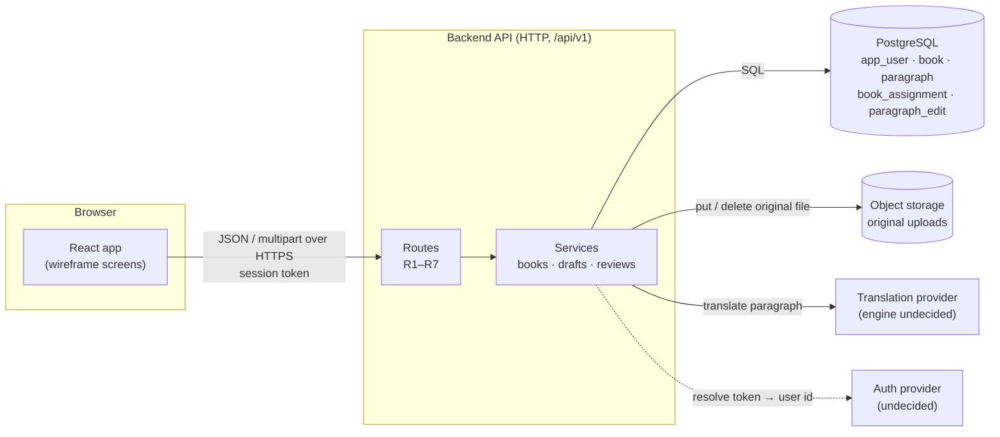
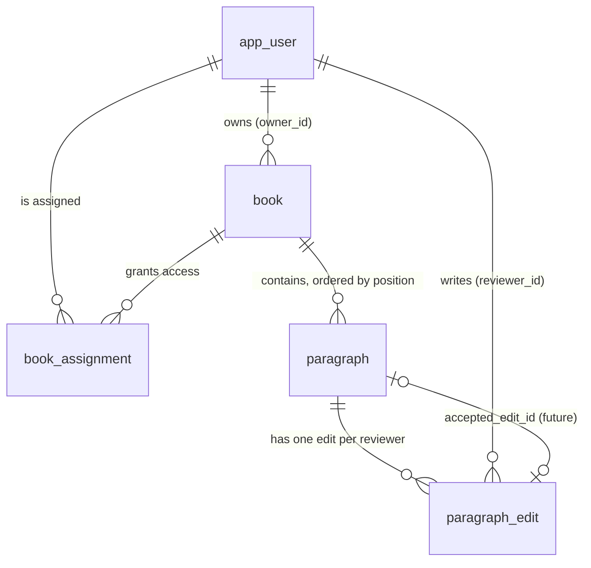

# Week 6 Architecture Proposal: Translation Review App

*Proposed design, not an implementation. Written 2026-10-22 by Alex Mekhail with AI assistance (Claude); see [`../prompt-logs/week-06.md`](../prompt-logs/week-06.md). Source of truth for the PRD and UX: the Week 5 PRD and this repository's wireframe (`src/`).*

## Summary

I propose managed **PostgreSQL** for application records and **object storage** for original uploads. The schema keeps source and machine text on the paragraph and stores each reviewer's correction in its own `paragraph_edit` row. That way, the single-reviewer MVP can grow into multi-reviewer crowdsourcing by adding rows, not by rewriting tables.

In this document, "book" means the PRD's "document." The MVP is still one reviewer per book.

| Deliverable | Status | What remains |
| --- | --- | --- |
| 1. Database choice and tradeoffs | Complete | Hosting provider (Supabase vs. Neon) not chosen |
| 2. Complete proposed schema | Complete | Page-limit unit (pages vs. words) still open |
| 3. Book and paragraph API routes | Complete | Auth provider not chosen; permissions are stated as assumptions |
| 4. Human review and revision | Partial | Four revisions recorded; Alex's own written challenge still to be added to the prompt log |

## Scope and assumptions

The proposal covers the reviewer MVP from the Week 5 PRD and wireframe. Crowdsourcing shapes the model but adds no MVP features.

**Known** (from the PRD, the wireframe, and Alex's answers)

- One bilingual volunteer reviewer per book in the MVP. Arabic to English only.
- Digital .docx, PDF, or .txt uploads of at least 30 pages; no scanned PDFs.
- Upload and translate is one step; the server splits the file into paragraphs.
- Review opens only after every paragraph has a machine draft.
- Each paragraph keeps its machine text; the diff is machine vs. the reviewer's current text.
- Paragraph done and book done are independent; done never locks editing.
- Autosave sends one paragraph's change at a time (text or done flag).
- Long-term direction: many reviewers per book, like crowdsourcing.

**Assumed**

- A 30-page book is a few hundred paragraphs and well under a few MB of text. *Illustrative; not measured.*
- Reviewers are online while editing; no offline mode.
- Saves are infrequent per paragraph (seconds apart), so write volume is low.
- A chapter heading is a plain paragraph.

**Needs validation**

- Real paragraph counts and text size from sample religious and literary files.
- Whether texts may be sent to a third-party translation engine.
- How the page limit is measured (file pages vs. words).
- Which auth provider issues user identities.

## Component and data flow



Upload: the browser posts the file → the API stores the original in object storage, writes the book, assignment, and paragraph rows to PostgreSQL, then asks the provider for each paragraph's draft. Review: the browser reads one book's ordered paragraphs and sends one-paragraph `PATCH` saves; only PostgreSQL is touched.

## 1. Database choice and tradeoffs

Recommendation: managed **PostgreSQL** for books, paragraphs, assignments, and edits, plus **object storage** (such as S3 or Supabase Storage) for the original uploaded files. The alternative considered is **Cloud Firestore** (Native mode).

**Requirements that drive the choice**

| Requirement | What the product needs | PostgreSQL | Firestore |
| --- | --- | --- | --- |
| Document/paragraph access | Load all paragraphs of one book in reading order | One query with `ORDER BY position`; order is unspecified without it ([sorting rows](https://www.postgresql.org/docs/18/queries-order.html)) | A `paragraphs` subcollection queried with `orderBy('position')` |
| Relationships | Book → paragraphs → per-reviewer edits; user ↔ book assignments | Foreign keys and joins in one query | Standard-edition queries have no joins; data is denormalized or read in several queries (Enterprise-edition pipelines add subquery joins; not evaluated here) |
| Ordering integrity | No two paragraphs share a position in a book | `UNIQUE (book_id, position)` enforced by the database | Must be enforced in application code or a transaction |
| Update visibility | A saved correction is visible on the next read | Default isolation is Read Committed: a statement sees rows committed before it began ([SET TRANSACTION](https://www.postgresql.org/docs/10/sql-set-transaction.html)) | Real-time listeners push changes to open clients, and show local writes before the server confirms ([listen](https://docs.cloud.google.com/firestore/docs/query-data/listen)) |
| Progress and crowdsourcing queries | "12 / 40 done," and later "how many reviewers agree" | `COUNT`, `GROUP BY`, and joins across edits | `count()`, `sum()`, `average()` only; aggregations skip real-time listeners and time out after 60 seconds ([aggregation](https://docs.cloud.google.com/firestore/docs/query-data/aggregation-queries)) |
| Data size | A few hundred paragraphs per book (assumed) | Small for either system | Fits the per-document limit of 1 MiB if each paragraph is its own document ([quotas](https://docs.cloud.google.com/firestore/quotas)) |
| Operational burden | A student-run project | Managed host handles backups and upgrades; schema migrations are our job | Serverless; no schema, but index configuration and security rules are our job |
| Cost factors | Low traffic | Billed mostly by instance size and storage | Billed mostly per read, write, and delete operation; a full-book load reads every paragraph document |
| Migration later | Crowdsourcing adds reviewers and edits | New tables and rows; existing data unchanged | Usually restructuring documents, since data is shaped around read paths |

**Why Firestore is less suitable for this scope.** Its strengths, real-time sync and serverless scaling, are not MVP needs: the MVP has one reviewer per book and low write volume. Its gaps hit the crowdsourcing direction directly. Comparing edits across reviewers, counting agreement, and listing "books assigned to me" are join and aggregation work, which PostgreSQL does natively. Firestore would also need application code to keep positions unique.

**Where Firestore would win.** If a later phase needs live co-editing, where reviewers see each other's changes instantly, Firestore's listeners handle that without extra infrastructure. In PostgreSQL that would need a separate realtime layer. Live co-editing is out of scope.

**File storage is separate.** Uploaded .docx, PDF, and .txt files go to object storage. The `book` row keeps only the object key. Parsed paragraph text lives in PostgreSQL because it is edited, ordered, and queried.

**Not claimed.** No latency or throughput numbers are claimed, and no free-tier allowance is treated as a requirement. Hosting provider and its pricing still need to be chosen.

## 2. Complete proposed schema

Five tables. Source and machine text belong to the paragraph and never change after translation. Each reviewer's correction and done flag belong to that reviewer's `paragraph_edit` row. Book access comes from `book_assignment`, not from ownership alone.

All `id` columns are UUIDs generated by the database. All timestamps are `timestamptz`. "Req." means `NOT NULL`.

**`app_user`** (named to avoid the reserved word `user`)

| Column | Type | Req. | Constraints and notes |
| --- | --- | --- | --- |
| id | uuid | Yes | Primary key; matches the auth provider's user id |
| email | text | Yes | `UNIQUE` |
| display_name | text | No | |
| created_at | timestamptz | Yes | Default `now()` |

**`book`**

| Column | Type | Req. | Constraints and notes |
| --- | --- | --- | --- |
| id | uuid | Yes | Primary key |
| owner_id | uuid | Yes | FK → `app_user.id`; the uploader |
| title | text | Yes | Defaults to the file name without extension |
| source_lang | text | Yes | `CHECK (source_lang = 'ar')` in MVP |
| target_lang | text | Yes | `CHECK (target_lang = 'en')` in MVP |
| source_file_key | text | Yes | Object-storage key of the original upload; storage owned by the app, not the user |
| source_file_type | text | Yes | `CHECK IN ('docx','pdf','txt')` |
| page_count | integer | No | `CHECK (page_count > 0)`; unit still to validate |
| pipeline_status | text | Yes | `CHECK IN ('uploaded','translating','ready','failed')` |
| translation_engine | text | No | Which engine produced the drafts; engine itself undecided |
| created_at, updated_at | timestamptz | Yes | |

**`paragraph`**

| Column | Type | Req. | Constraints and notes |
| --- | --- | --- | --- |
| id | uuid | Yes | Primary key; stable identity, never reused |
| book_id | uuid | Yes | FK → `book.id`, `ON DELETE CASCADE` |
| position | integer | Yes | Display order, starting at 1; `UNIQUE (book_id, position)`; `CHECK (position > 0)` |
| source_ar | text | Yes | Arabic source; read-only after upload |
| machine_en | text | No | Null until translated; never overwritten by reviewers |
| translation_status | text | Yes | `CHECK IN ('pending','translated','failed')` |
| translation_error | text | No | Last engine error, for retry |
| accepted_edit_id | uuid | No | FK → `paragraph_edit.id`; null in MVP; reserved for the future accepted version |
| created_at, updated_at | timestamptz | Yes | |

**`book_assignment`**

| Column | Type | Req. | Constraints and notes |
| --- | --- | --- | --- |
| book_id | uuid | Yes | FK → `book.id`, `ON DELETE CASCADE` |
| user_id | uuid | Yes | FK → `app_user.id` |
| role | text | Yes | `CHECK IN ('reviewer')` in MVP; later 'second_reviewer', 'publisher' |
| completed_at | timestamptz | No | Set by "Mark document done"; cleared by Undo |
| assigned_at | timestamptz | Yes | |
| | | | Primary key `(book_id, user_id, role)` |

**`paragraph_edit`**

| Column | Type | Req. | Constraints and notes |
| --- | --- | --- | --- |
| id | uuid | Yes | Primary key |
| paragraph_id | uuid | Yes | FK → `paragraph.id`, `ON DELETE CASCADE` |
| reviewer_id | uuid | Yes | FK → `app_user.id` |
| text_en | text | Yes | The reviewer's current English; starts as a copy of `machine_en` |
| is_done | boolean | Yes | Default `false`; per reviewer |
| version | integer | Yes | Starts at 1; incremented on every save; used for conflict checks |
| updated_at | timestamptz | Yes | |
| | | | `UNIQUE (paragraph_id, reviewer_id)`: one current edit per reviewer per paragraph |

**Derived, not stored**

- *Edited*: `text_en <> machine_en`.
- *Diff*: computed from `machine_en` and `text_en` when shown.
- *Progress*: `COUNT(*) FILTER (WHERE is_done)` over the reviewer's edits for the book.
- *Book shown as Done*: the reviewer's assignment has `completed_at` set. Pipeline status stays `ready`.

**Future proposals, not MVP:** chapter and section structure, book metadata (author, era, genre), glossary tables, full edit history, and a projects table for the Project Manager.

### How the tables relate



A book has many paragraphs; each paragraph has one edit per reviewer. Access runs through `book_assignment`, so adding a reviewer is one new assignment row plus their edit rows.

## Sample data, order, and save-then-read

One book with three paragraphs, from the wireframe's mock data. *All ids, names, and timestamps are illustrative; UUIDs are shortened.*

**`book`**

| id | owner_id | title | source_file_key | pipeline_status |
| --- | --- | --- | --- | --- |
| b-01 | u-alex | The Merchant and His Sons | uploads/b-01/merchant.docx | ready |

**`book_assignment`**

| book_id | user_id | role | completed_at |
| --- | --- | --- | --- |
| b-01 | u-alex | reviewer | null |

**`paragraph`**

| id | book_id | position | source_ar | machine_en | translation_status |
| --- | --- | --- | --- | --- | --- |
| p-7f3a | b-01 | 1 | كان في قديم الزمان تاجر يسافر بين المدن. | In old times there was a merchant who travel between the cities. | translated |
| p-1c90 | b-01 | 2 | وكان له ثلاثة أبناء لا يحبون العمل. | And he had three sons who do not love the work. | translated |
| p-e244 | b-01 | 3 | فقال لهم يومًا: إن المال لا يبقى لمن لا يحفظه. | So he say to them one day: The money does not stay for who does not keep it. | translated |

**`paragraph_edit`**

| id | paragraph_id | reviewer_id | text_en | is_done | version |
| --- | --- | --- | --- | --- | --- |
| e-01 | p-7f3a | u-alex | Long ago, there was a merchant who traveled between cities. | true | 4 |
| e-02 | p-1c90 | u-alex | He had three sons who did not like to work. | true | 3 |
| e-03 | p-e244 | u-alex | So he say to them one day: The money does not stay for who does not keep it. | false | 1 |

Paragraph 3 is unedited: its `text_en` still equals `machine_en`, so it shows as "Machine text" with an empty diff.

**Identity vs. order.** `paragraph.id` identifies a paragraph forever; edits and future comments point at it. `position` only says where it is displayed. If a later phase inserts or reorders paragraphs, positions change but ids and all edits stay attached.

**Reading in order.** PostgreSQL returns rows in an unspecified order without `ORDER BY`, so the read always sorts explicitly:

```sql
SELECT p.id, p.position, p.source_ar, p.machine_en, p.translation_status,
       e.text_en, e.is_done, e.version
FROM paragraph p
LEFT JOIN paragraph_edit e
  ON e.paragraph_id = p.id AND e.reviewer_id = :current_user
WHERE p.book_id = :book_id
ORDER BY p.position;
```

**Save, then read again.** When a reviewer saves a correction:

1. The update to `paragraph_edit` commits before the API responds with success.
2. The response carries the new `version` and `updated_at`.
3. Any later read, including a reload on another device, returns the saved text. Read Committed guarantees a new statement sees rows committed before it began.
4. If the save fails, nothing is committed. The client keeps the edit, shows "Save failed – retrying," and resends.
5. If the sent `version` is older than the stored one, the update changes nothing and the API returns `409 Conflict` with the current text, so a stale tab cannot overwrite newer work.

## 3. Book and paragraph API routes

Seven routes cover the reviewed user flow. All are JSON over HTTPS under `/api/v1`, except the upload, which is `multipart/form-data`.

**Identity and permission assumptions**

- Every request carries a session token from an auth provider (not yet chosen). The server resolves it to `app_user.id`; a missing or invalid token returns `401`.
- **Access to one book** requires a `book_assignment` row for the caller on that book. Without one, the API returns `404`, not `403`, so it does not reveal that the book exists.
- **Access to every book** (an admin view) is not in the MVP. It is a P1 Admin feature and would need its own role check.
- In the MVP, uploading a book automatically assigns the uploader as its reviewer.
- The "adding paragraphs" route is internal: only the upload pipeline calls it, never a reviewer's browser.

**Common errors**

| Status | When |
| --- | --- |
| 400 | Request body fails validation |
| 401 | No valid session |
| 404 | Book or paragraph not found, or caller has no assignment |
| 409 | Version conflict, or the book is in the wrong pipeline state |
| 413 | File too large |
| 415 | Unsupported file type |
| 422 | File is valid but unusable (scanned PDF, over page limit, no Arabic text) |

**R1. Create a book from an upload** — `POST /api/v1/books`

- Screen: Upload → "Upload & translate."
- Request (multipart): `file` (required), `title` (optional; defaults to file name).
- Effects: stores the file in object storage; creates `book` with `pipeline_status = 'uploaded'`; creates the uploader's `book_assignment`; calls R2 with the parsed paragraphs; starts translation.
- Response `201`: `{ id, title, pipeline_status, page_count, paragraph_count, created_at }`.
- Failures: `415` wrong type; `422` with `code` = `scanned_pdf`, `over_page_limit`, or `empty`; `413` too large.

**R2. Add paragraphs (internal)** — `POST /api/v1/books/{bookId}/paragraphs`

- Caller: the upload pipeline only.
- Request: `{ paragraphs: [ { position, source_ar } ] }`; positions must be 1…n with no gaps or duplicates.
- Effects: inserts all rows in one transaction with `translation_status = 'pending'`. Either all are added or none.
- Response `201`: `{ count }`.
- Failures: `409` if the book already has paragraphs; `400` on duplicate or missing positions.

**R3. List my books** — `GET /api/v1/books`

- Screen: Document list.
- Response `200`: `{ books: [ { id, title, created_at, pipeline_status, completed_at, paragraph_count, translated_count, done_count } ] }`, newest first.
- Only books the caller is assigned to. `done_count` counts the caller's own edits.

**R4. Get one book with paragraphs** — `GET /api/v1/books/{bookId}`

- Screens: Translating and Review.
- Response `200`: `{ id, title, pipeline_status, completed_at, paragraphs: [ { id, position, source_ar, machine_en, translation_status, my_edit: { text_en, is_done, version, updated_at } | null } ] }`.
- Paragraphs are always returned ordered by `position`.
- In the MVP the full book is returned in one response; a few hundred paragraphs is assumed to be small enough. Paging is a future option if real files are larger.

**R5. Retry failed translations** — `POST /api/v1/books/{bookId}/translations/retry`

- Screen: Translating → "Retry failed."
- Effects: sets failed paragraphs back to `pending` and the book to `translating`.
- Response `202`: `{ retried_count }`.
- Failures: `409` if the book has no failed paragraphs.

**R6. Save a correction** — `PATCH /api/v1/books/{bookId}/paragraphs/{paragraphId}/edits/me`

- Screen: Review → typing in the English box, ticking "Mark done," or "Reset to machine text."
- Request: any subset of `{ text_en, is_done }`, plus required `base_version` (the version the client last saw; `0` if it has no edit yet).
- Effects: creates the caller's edit on first save (copying `machine_en` if `text_en` is absent), otherwise updates only the sent fields where `version = base_version`, then increments `version`.
- Response `200`: `{ text_en, is_done, version, updated_at }`.
- Failures: `409` with the current edit if `base_version` is stale; `409` if the paragraph is not yet translated; `400` if neither field is sent.
- Reset to machine text is a normal save with `text_en` set to the machine text.

**R7. Mark book done or reopen** — `PATCH /api/v1/books/{bookId}/assignments/me`

- Screen: Review → "Mark document done" or "Undo."
- Request: `{ completed: true | false }`.
- Effects: sets or clears `completed_at` on the caller's assignment. Never locks editing.
- Response `200`: `{ completed_at }`.

**Partial vs. full updates.** R6 and R7 are partial (`PATCH`): autosave sends only the field that changed, so a done-tick never resends the text. A full `PUT` replacement was rejected because a slow text save could overwrite a newer done flag, or the reverse.

**Why `/edits/me`.** The path names the caller's own edit, so a reviewer can never write to another reviewer's edit. When more reviewers join, R6 is unchanged; a future read route such as `GET /paragraphs/{id}/edits` can list everyone's edits for a second-phase reviewer.

## Trace: correcting paragraph 1

The reviewer fixes paragraph 1 of *The Merchant and His Sons* on the Review screen, the save commits, and a reload shows the corrected text in order. *Values are illustrative.*

1. **Wireframe.** On `#/review/merchant`, the reviewer changes the English box for ¶ 1 to "Long ago, there was a merchant who traveled between cities." The indicator shows *Saving…* (wireframe `src/screens/Review.tsx`, `PairRow`).
2. **Client.** After typing pauses, autosave sends R6:

   ```http
   PATCH /api/v1/books/b-01/paragraphs/p-7f3a/edits/me
   { "text_en": "Long ago, there was a merchant who traveled between cities.", "base_version": 3 }
   ```
3. **Permission.** The server resolves the token to `u-alex` and finds a `book_assignment` row for `(b-01, u-alex)`. It checks that `p-7f3a` belongs to `b-01` and is `translated`.
4. **Stored records.** One row changes, in one statement:

   ```sql
   UPDATE paragraph_edit
   SET text_en = :text_en, version = version + 1, updated_at = now()
   WHERE paragraph_id = 'p-7f3a' AND reviewer_id = 'u-alex' AND version = 3
   RETURNING text_en, is_done, version, updated_at;
   ```

   `paragraph.machine_en` is untouched, so the diff stays available.
5. **Response.** One row updated → `200 { text_en, is_done: false, version: 4, updated_at }`. Zero rows updated means a newer save exists → `409` with the current edit.
6. **Back to the wireframe.** The indicator shows *Saved*. The pair is labeled *Edited*, and Show diff renders machine text vs. the new text. On `409`, the client shows the newer text and asks the reviewer to reapply their change.
7. **Read again.** On reload, R4 returns paragraphs `ORDER BY position`, with ¶ 1's `my_edit.text_en` set to the corrected text and `version: 4`.

## 4. Human review and revision log

The AI restated its understanding before drafting, the wireframe code was reviewed against the PRD, and the crowdsourcing challenge changed the data model. Four revisions and one challenge that survived are recorded below. The prompt log has the matching excerpts.

**Restatement.** Before drafting, the AI restated the MVP (one reviewer, paragraph-level review, machine vs. final diff, done not locked) and the four deliverables, then asked 15 questions. Answers came from Alex and from the wireframe repo.

| # | First proposal | Challenge | Evidence | Revision |
| --- | --- | --- | --- | --- |
| 1 | `final_en` and `is_done` stored on `paragraph` | Alex: the app should grow into crowdsourced review by many reviewers | One column per paragraph can hold only one reviewer's answer | Moved to a per-reviewer `paragraph_edit` table with `UNIQUE (paragraph_id, reviewer_id)` |
| 2 | One `book.status` from uploaded to done | Same challenge | "Done" is per reviewer once there are many; the pipeline is per book | Split into `book.pipeline_status` and `book_assignment.completed_at` |
| 3 | PRD diagram treated "Translation failed" as a brief state | Wireframe review | `Translating.tsx` keeps the book failed and blocks Review until retry succeeds | Schema keeps `failed` as a stored pipeline status; R6 refuses saves on untranslated paragraphs |
| 4 | "Firestore has no joins" | Primary-doc check | Firestore docs list subquery joins under Enterprise-edition pipelines | Claim narrowed to Standard-edition queries |

**Challenge that survived: integer positions.** The draft was challenged to use fractional or gapped order keys so paragraphs can be inserted later. The wireframe has no add, split, merge, or reorder action, and paragraphs are created once by the upload pipeline. Integer `position` with a unique constraint was kept; insertion is recorded as a future question.

## Remaining decisions and future work

Five decisions are open before building; crowdsourcing features are deferred but fit the model by adding tables or rows.

**Open decisions**

- [ ] Hosting provider for PostgreSQL and object storage, and its cost.
- [ ] Auth provider that issues `app_user.id`.
- [ ] Translation engine, and whether the texts may be sent to it.
- [ ] Page-limit unit: file pages or a word count.
- [ ] Real paragraph counts from sample files, to confirm R4 can return a whole book at once.

**How crowdsourcing fits later**

| Future feature | Change to this design |
| --- | --- |
| More reviewers per book | More `book_assignment` and `paragraph_edit` rows; no schema change |
| Second-phase reviewer | New `role` value; reads all edits; sets `paragraph.accepted_edit_id` |
| Publisher and export | New role and an export route that reads accepted or latest edits |
| Comments and flags | New `comment` table referencing `paragraph.id` |
| Full edit history | New append-only `paragraph_edit_revision` table beside `paragraph_edit` |
| Voting, consensus, reputation | New tables; rules to be designed |
| Admin "all books" view | Role check on the admin user; new route |

**Kept outside the MVP:** live co-editing, partitioning, offline sync, rich chapter structure, paragraph insert or reorder, and implementation planning.

## Sources

Primary documentation opened for this proposal:

- [PostgreSQL 18: Sorting Rows (ORDER BY)](https://www.postgresql.org/docs/18/queries-order.html)
- [PostgreSQL: SET TRANSACTION (default isolation level)](https://www.postgresql.org/docs/10/sql-set-transaction.html) — version 10 page; confirm against the current version
- [Firestore: Quotas and limits](https://docs.cloud.google.com/firestore/quotas)
- [Firestore: Summarize data with aggregation queries](https://docs.cloud.google.com/firestore/docs/query-data/aggregation-queries)
- [Firestore: Best practices](https://docs.cloud.google.com/firestore/docs/best-practices)
- [Firestore: Get real-time updates](https://docs.cloud.google.com/firestore/docs/query-data/listen)

PostgreSQL constraint behavior (`UNIQUE`, `FOREIGN KEY`, `CHECK`, `ON DELETE CASCADE`) is standard, but its documentation page could not be opened while drafting. **Unverified citation:** add the PostgreSQL "Constraints" chapter link before submitting.
